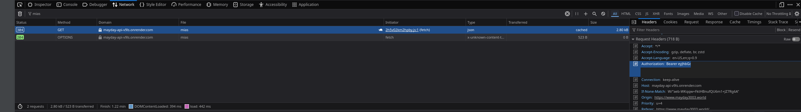

# Mayday Web

Frontend de **Mayday · Bitácora y muro de recuerdos**: mis intereses, mis proyectos de investigación y un muro de recuerdos con las personas que amo. Es la migración a Next.js de la Entrega 1, conectada a la API REST de la Entrega 2.

| | |
|---|---|
| Frontend en producción | https://www.mayday3003.world |
| Repo del frontend | https://github.com/Mayday3003/mayday-web |
| API en producción | https://mayday-api-v9ls.onrender.com ([`/health`](https://mayday-api-v9ls.onrender.com/health)) |
| Repo de la API | https://github.com/Mayday3003/mayday-api |

> La API está en el plan gratuito de Render: después de 15 minutos sin uso se duerme y la primera petición tarda unos 50 segundos. Mientras tanto la página muestra "La API está despertando" con un botón para reintentar.

## Credenciales de prueba

| Rol | Email | Contraseña |
|---|---|---|
| admin | `admin@mayday3003.world` | `AdminMayday2026*` |
| user | `evaluador@mayday3003.world` | `UserMayday2026*` |

También puedes crear una cuenta en `/registro` (siempre queda con rol `user`).

## Stack

Next.js 16 (App Router) · React 19 · TypeScript estricto · Tailwind CSS v4 · desplegado en Vercel con auto-deploy desde `main`.

## Correrlo localmente

```bash
git clone https://github.com/Mayday3003/mayday-web.git
cd mayday-web
npm install
cp .env.example .env.local   # y ajusta la URL de la API si corres el backend local
npm run dev                  # http://localhost:3000
```

Otros scripts: `npm run build` (build de producción) y `npm run lint`.

## Variables de entorno

| Variable | Para qué |
|---|---|
| `NEXT_PUBLIC_API_HOST` | URL base de la API, sin `/` final. En producción: `https://mayday-api-v9ls.onrender.com`. Para desarrollo con el backend local: `http://localhost:4000` |

`.env.local` no se sube al repo; `.env.example` sí.

## Páginas

| Ruta | Acceso | Qué hace |
|---|---|---|
| `/` | público | Inicio: lo que amo, últimas fotos (desde la API) y canciones |
| `/proyectos` | público | Proyectos de investigación (contenido fijo de la Entrega 1) |
| `/muro` | público | Catálogo: búsqueda, filtros combinados (tipo, persona, fechas) y paginación en la URL (`?page=2&type=viaje…`) |
| `/muro/[id]` | público | Detalle del recuerdo con sus comentarios; comentar requiere sesión |
| `/muro/nuevo` | con sesión | Proponer un recuerdo (el formulario de la Entrega 1), con foto desde el dispositivo o por enlace |
| `/mis-recuerdos` | con sesión | Mis propuestas con su estado y mis comentarios |
| `/admin` | solo admin | CRUD de experiencias con subida de imagen y confirmación al eliminar, revisión de propuestas y todos los comentarios |
| `/login` · `/registro` | solo sin sesión | Formularios con errores debajo de cada campo |
| cualquier otra | — | 404 propia |

Cada pantalla que pide datos tiene sus tres estados: cargando, vacío y error (con reintentar).

## Estructura

```
app/                        # rutas (App Router); cada page.tsx solo arma la pantalla
proxy.ts                    # redirecciones en el servidor según la cookie (ver abajo)
src/features/
  common/                   # http.ts, session.ts, config.ts, componentes base, guards
  auth/                     # login, registro, useAuth
  experiencias/             # catálogo, detalle y admin de experiencias
  interacciones/            # comentarios
  propuestas/               # proponer recuerdos, mis recuerdos, revisión del admin
  proyectos/ · musica/      # contenido fijo de la Entrega 1
```

Cada feature separa `domain/` (tipos), `services/` (llamadas a la API), `hooks/` y `components/`. El único `fetch` del proyecto está en `src/features/common/http.ts`.

## Protección de rutas

Hay dos capas, y ninguna de las dos es la seguridad real:

1. **`proxy.ts` (servidor):** lee la cookie `mayday_token` y redirige antes de pintar la página (`/admin` sin rol admin → `/`; rutas privadas sin sesión → `/login?next=…`; `/login` y `/registro` con sesión → `/`). Lee el rol del payload del JWT **sin verificar la firma**, porque el secreto solo existe en la API.
2. **Guards en el cliente** (`PrivateRoute`, `AdminRoute`, `GuestRoute`): hacen lo mismo cuando se navega dentro de la app, y no muestran el contenido hasta saber si hay sesión.

La seguridad real está en la API: cualquier petición sin token responde **401** y con un rol sin permiso responde **403**, aunque alguien se salte el frontend.

## Captura de Network

<!-- Pega aquí la captura de DevTools → Network de una petición protegida
     (por ejemplo GET /api/propuestas/mias) donde se vea el header
     "Authorization: Bearer …". Guárdala en docs/ y enlázala así:
      -->

## Decisiones técnicas

<!--
  ESTA SECCIÓN LA ESCRIBES TÚ, con tus palabras (el profe lo pide sin IA).
  Preguntas guía; borra este comentario cuando termines:

  1. Flujo del login: ¿qué pasa desde que escribes el correo y la contraseña hasta que
     la navbar cambia? (LoginForm → useAuth.login → authService → http.ts → la API
     responde { token, user } → saveSession guarda la cookie y el usuario → la navbar
     se entera por useSyncExternalStore)
  2. ¿Dónde guardas el token y por qué ahí? (cookie mayday_token, no httpOnly porque
     el cliente la lee para armar el header; proxy.ts también la lee en el servidor)
  3. ¿Qué riesgo tiene y cómo lo mitigas? (XSS podría leerla; React escapa el HTML,
     no se usa dangerouslySetInnerHTML, SameSite=Lax, Secure en https, expira en 1 día)
  4. ¿Cómo sabe cada petición quién eres? (http.ts agrega Authorization: Bearer <token>)
  5. 401 vs 403 desde el frontend: ¿qué hace la app con cada uno? (401 con token →
     cierra la sesión y manda a /login?expirado=1; 403 → muestra el mensaje)
  6. ¿Por qué "ocultar un botón no es proteger una ruta"? (proxy y guards son
     experiencia de usuario; quien protege es la API)
  7. ¿Por qué el formulario ya no pide "correo de contacto"? (el autor sale del token)
  8. Uso de IA: qué le pediste, qué cambiaste tú y qué aprendiste.
-->
